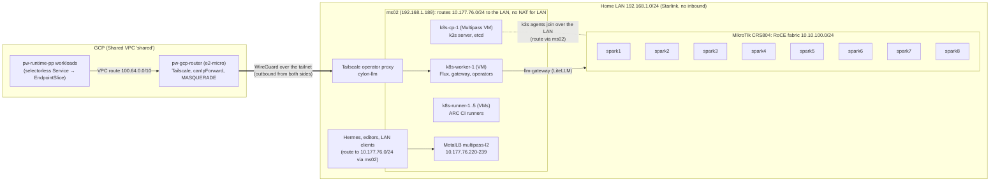
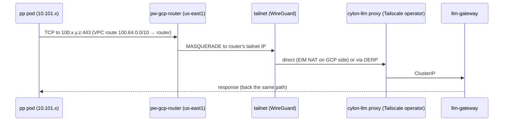

# Design — the Cylon GPU cluster: eight DGX Sparks under Kubernetes, vLLM as pods

Status: **draft for review** (24 Oct 2026, revised the same day: the MS-A2 is off the table — memory shortages push its
delivery out — so the Sparks join the existing ms02 k3s cluster). Owner: Charles.
**Phase status (24 Oct 2026): vLLM is now served from Kubernetes** on nvidia1/nvidia2 (spark1/spark2) — see 5.7.
The Docker serving stack is retired on cylon nodes.

This document replaces the Docker + Ansible serving stack on the Sparks by making all eight GX10 units GPU nodes of the
existing **ms02 k3s cluster** (control plane in a Multipass VM on ms02), serving vLLM as pods, reachable from
PriceWhisperer's GCP pp runtime cluster over a private tunnel. It
reverses an earlier decision recorded in [`llmwiki/concepts/8-spark-fabric-and-orchestrator.md`](../llmwiki/concepts/8-spark-fabric-and-orchestrator.md)
("stay on Docker + Ansible, no k3s on the MS-A2, Kubernetes on the Pi cluster"); section 2 says why.

Contents

1. [Where we are](#1-where-we-are)
2. [Why Kubernetes, and why now](#2-why-kubernetes-and-why-now)
3. [Goals and non-goals](#3-goals-and-non-goals)
4. [Architecture at a glance](#4-architecture-at-a-glance)
5. [The cluster: control plane, nodes, GitOps](#5-the-cluster-control-plane-nodes-gitops)
6. [Node layer: what Ansible keeps doing](#6-node-layer-what-ansible-keeps-doing)
7. [GPU and RDMA in pods](#7-gpu-and-rdma-in-pods)
8. [Serving: vLLM workloads](#8-serving-vllm-workloads)
9. [Models and images](#9-models-and-images)
10. [The API surface: gateway, names, auth](#10-the-api-surface-gateway-names-auth)
11. [Failure handling (the GX10 power-off bug and friends)](#11-failure-handling)
12. [Observability](#12-observability)
13. [Tunnel: GCP pp workloads → Cylon](#13-tunnel-gcp-pp-workloads--cylon)
14. [Networks and address plan](#14-networks-and-address-plan)
15. [Security and data rules](#15-security-and-data-rules)
16. [Upgrades](#16-upgrades)
17. [Migration plan (phased)](#17-migration-plan-phased)
18. [Decisions to make](#18-decisions-to-make)
19. [Risks](#19-risks)
20. [Appendix: facts this design rests on](#20-appendix-facts-this-design-rests-on)

---

## 1. Where we are

| | Today |
|---|---|
| Hardware | 8 × ASUS Ascent GX10 (NVIDIA GB10, 20 Grace cores, ~121 GiB unified LPDDR5X, ConnectX-7 with 2 QSFP cages). **2 in service** (nvidia1 `192.168.1.104`, nvidia2 `192.168.1.229`); **6 unboxed since 20 May 2026**, deliberately not brought up until there is a proper Kubernetes setup. |
| Planned hardware | ~~Minisforum MS-A2 as `orchestrator1`~~ (dropped 24 Oct 2026: delivery times, memory shortages); MikroTik **CRS804-4DDQ-HRM** (4 × 400G QSFP-DD, broken out to 8 × 200G QSFP56) as the Spark fabric switch; a 20-blade ComputeBlade (Pi 5) cluster for general workloads. |
| OS | DGX OS (Ubuntu 24.04 aarch64), kernel pinned `6.17.0-1018-nvidia` (4K pages), OTA masked, driver 580.142, CUDA 13.1. |
| Fabric | One DAC between nvidia1/nvidia2, cage A. Fabric 1 `enp1s0f0np0` (169.254 link-local, MTU 9000), fabric 2 `enP2p1s0f0np0` (10.200.0.0/30), dual-HCA RoCE (23.75 GB/s all-reduce). Plan: `10.10.100.0/24` once the switch is in. |
| Serving | NGC `nvcr.io/nvidia/vllm:26.03-py3` (pinned: 26.04 dropped `ray`). Ray head container on nvidia1, worker on nvidia2, `--network host`, `--restart unless-stopped`. `vllm serve` is **not** the container's process: Ansible starts it with `docker exec -d`. Profile `qwen38`: Qwen3.8-27B-FP8, TP=2, 512k context (YaRN ×2), served as `gpt-4o-mini`, `qwen3` and three other aliases, port 8000. |
| Models | HF cache on local NVMe (`/home/nvidia/.cache/huggingface`), `hf-prefetch.service` downloads on the leader and rsyncs to peers over QSFP; ms02 NFS (`/srv/hf-archive`) as cold store for very large models. |
| Consumers | Hermes on ms02, Cursor/Zed/pi-cli, hauliage's document extraction (PII: must only ever go to this cluster), CI release notes (from 24 Oct 2026). |
| Observability | node_exporter, dcgm-exporter, vLLM `/metrics` → otelcol → ms02; promtail → ms02 Loki. **The ms02 observability stack is currently scaled to zero**, so nothing lands. |
| Networking | Home LAN `192.168.1.0/24` behind a consumer Starlink router: **no inbound**, CGNAT implied. ms02 has WireGuard `wg0` (10.77.0.0/24) and a reverse SSH tunnel to the Hostinger VPS (76.13.1.95). The Sparks are on neither. GCP has a Tailscale subnet router (`pw-gcp-router`, e2-micro, us-east1) that routes *into* GCP only. |

What went wrong on 3 Oct 2026 is the clearest statement of the problem: both Sparks rebooted cleanly, the containers came
back by restart policy, and `vllm serve` — a detached `docker exec` — did not. The API was down for three weeks while
every container showed "Up". Nothing in the stack knew what "serving" meant.

## 2. Why Kubernetes, and why now

The Docker + Ansible stack was the right call for two hosts. It does not scale to eight, and the reasons are the ones
Kubernetes exists for:

- **The served process is not supervised.** A pod whose main process is `vllm serve`, with readiness and liveness on
  `/health`, comes back after a reboot or a crash without anyone noticing it was gone.
- **Placement.** Eight nodes means choosing which model runs where (one TP=8 giant, four TP=2 replicas, a mix), and
  changing that without re-cabling Ansible variables per host. Today several `just` recipes and the autoupgrade daemon
  name nvidia1/nvidia2 directly; the fabric-2 /30 and probe peers only work for two hosts.
- **Failure domains.** The GX10 abrupt power-off bug is unresolved. With eight nodes, a lost node should mean the
  affected replica is rebuilt on spare capacity, not a page.
- **One way to ship anything.** Flux already delivers everything else Charles runs. Models, images, gateway config and
  routing become Git changes with the same review and rollback as the rest.
- **A stable endpoint.** Consumers point at a name, not at `192.168.1.104:8000` on whichever node is rank 0.

The earlier objection — RoCE in pods is hard (hostNetwork vs Multus/SR-IOV) — is real but small: section 7 takes the
`hostNetwork` route, which is exactly what `docker run --network host --device /dev/infiniband` does today, so the NCCL
setup that works carries over unchanged.

## 3. Goals and non-goals

Goals

1. All eight Sparks are Kubernetes nodes, brought up from bare DGX OS by one repeatable path (Ansible for the host,
   Flux for everything in the cluster). No per-host hand work, nothing named after a specific node in the serving layer.
2. vLLM runs as pods whose main process is the server. A node or process failure is recovered without a human.
3. Several models can run at once, each as one or more replicas of a TP group, placed by labels, changed in Git.
4. One stable, authenticated OpenAI-compatible API for the LAN (Hermes, CI, editors) and for GCP pp workloads.
5. GPU, fabric, vLLM and node metrics and logs land somewhere that is actually running.
6. The six new Sparks come up straight into Kubernetes; the two serving Sparks migrate without a gap in service.

Non-goals (for now)

- Training or fine-tuning (the GCP README defers "GPU training in GCP" until a job outgrows the owned GB10 estate).
- Multi-tenant scheduling of arbitrary GPU jobs; this cluster serves models.
- Public exposure. Nothing here is reachable from the internet, ever.
- Running general workloads on the Sparks. The ms02 worker VMs (and later the Pi cluster) take those.
- Replacing Tailscale with fleetingDNS. Section 13 is written so the tunnel layer can be swapped when fleetingDNS lands.

## 4. Architecture at a glance



The pieces:

- **The existing ms02 k3s cluster** (v1.36, Multipass VMs, flannel vxlan, MetalLB, Flux from
  `microscaler/shared-gitops-k8s-cluster`). Its control plane stays where it is; the eight Sparks join it as tainted
  arm64 GPU agents. CPU-side pieces (gateway, operators) run on the existing amd64 worker VMs.
- **ms02 routes** between its Multipass bridge (`10.177.76.0/24`) and the LAN without NAT for LAN destinations, so VMs
  and Sparks see each other's real addresses (section 5.2).
- **Host layer stays in Ansible** (cylon-local-infra: kernel pin, UMA tuning, IPv6, GPU clock, fabric addressing, k3s
  agent install). **Cluster layer goes into shared-gitops** under the existing `cylon-infra` component.
- **GPU and RDMA** reach pods through the NVIDIA device plugin, an RDMA shared-device plugin and `hostNetwork`.
- **vLLM groups as LeaderWorkerSets**: one LWS per model, group size = tensor-parallel width, replicas = how many copies.
- **A gateway (LiteLLM)** in front of every model gives one URL, model aliases, API keys and per-consumer budgets, on an
  address from ms02's existing MetalLB pool.
- **Tailscale** carries pp → Cylon traffic: the Tailscale operator exposes the gateway on the tailnet; the existing GCP
  router forwards pp traffic to it.

## 5. The cluster: the Sparks join ms02's k3s

### 5.1 Why ms02's cluster

The MS-A2 that was to host a dedicated control plane is not coming (memory shortages push delivery out). The ms02
cluster is already running, already GitOps-managed, and already home to the CI runners and shared platform pieces, so
the Sparks join it rather than wait for hardware. What that costs, and how it is contained:

| Concern | Containment |
|---|---|
| Control plane shares a host (ms02) with CI | Serving pods keep running if the API server is down; etcd snapshots off-host (5.4); CI and GPU nodes isolated by taints, namespaces and PriorityClasses |
| VMs are NATed behind ms02 on `10.177.76.0/24`; Sparks are on the LAN | ms02 routes between the two without NAT (5.2) |
| Cluster is all amd64; Sparks are arm64 | Sparks are tainted; only workloads that tolerate the taint and ship arm64 images land there (5.3) |
| k8s-cp-1 is small (2 vCPU, 5.8 GiB, single etcd member) | Resize to 4 vCPU / 8 GiB before eight agents join (GitOps change in shared-gitops first, then the Multipass resize) |
| ms02 was heading for "CI only" | Deliberate exception: CI **and** the GPU estate's control plane and gateway. NCCL traffic never touches ms02 |

### 5.2 Networking between the VMs and the Sparks

Today the Multipass VMs reach the LAN through ms02's NAT, and LAN hosts reach the VMs only where a static route
`10.177.76.0/24 via 192.168.1.189` exists (the `metallb_lan_route` role installs it on ms02 and the Mac). k3s needs real,
symmetric addresses between every pair of nodes (kubelet ↔ API server, flannel VXLAN on UDP 8472), so:

1. **Route, don't NAT.** Every Spark gets the static route `10.177.76.0/24 via 192.168.1.189` (extend
   `metallb_lan_route` to the `sparks` group). On ms02, exempt LAN destinations from Multipass's masquerade
   (`iptables -t nat -I POSTROUTING -s 10.177.76.0/24 -d 192.168.1.0/24 -j RETURN`, persisted by an Ansible role) and
   allow forwarding between `mpqemubrzone1` and `eno4` for the ports k3s needs. VMs then see Sparks as `192.168.1.x`,
   Sparks see VMs as `10.177.76.x`, and flannel VXLAN runs over plain routed L3.
2. **Fix the stale firewall role.** `multipass_bridge_firewall` still names `mpqemubr0`; the live bridge is
   `mpqemubrzone1`. Spark UFW gains allow rules from `10.177.76.0/24` and the pod CIDR `10.42.0.0/16` for kubelet
   (10250), flannel (8472/udp) and the serving ports.
3. **Why not bridge the VMs onto the LAN instead?** It would work too (a bridged Multipass NIC on one of ms02's idle
   10G ports), but it changes every existing node's `--node-ip`, and re-IPing an embedded-etcd server is a disruptive
   migration. Routing leaves the running cluster untouched. Revisit only if the hop through ms02 shows in measurements;
   it carries control traffic and gateway → vLLM requests, never NCCL (that stays on the fabric).
4. **MTU**: LAN 1500, VXLAN overhead 50 → pod MTU 1450 everywhere; `--flannel-iface enP7s7` keeps the overlay on the
   Sparks' LAN NIC, never on the 9000-MTU fabric.

### 5.3 Joining a Spark

- Agent version **pinned to the server's** (`v1.36.2+k3s1`; one worker VM has already drifted to `v1.36.3`, which the
  upgrade plan in section 16 straightens out).
- Flags: `--node-ip <LAN IP> --flannel-iface enP7s7 --node-label cylon.microscaler.io/fabric=crs804
  --node-label cylon.microscaler.io/slot=N --node-label nvidia.com/gpu.product=GB10
  --node-taint nvidia.com/gpu=present:NoSchedule`, server URL the haproxy front `https://192.168.1.189:6443` that the
  `k8s_api_lan` role already exposes (it survives a control-plane VM re-IP; the VM's own `10.177.76.137:6443` works too).
- The join token is read from k8s-cp-1 at join time by Ansible (`multipass exec`), never written to Git or printed.
- k3s detects `nvidia-container-runtime` on the host (DGX OS ships it) and registers a `nvidia` runtime handler.
- **DaemonSet audit before the first join**: every DaemonSet that tolerates all taints must ship arm64 or carry
  `nodeAffinity: kubernetes.io/arch=amd64`. k3s's own pieces (flannel, kube-proxy) are in the binary and are fine;
  MetalLB speaker, log/metrics agents and democratic-csi node plugins are the ones to check.
- The Sparks get no ARC runners and no general pods: the taint does that, and ARC already targets its own runner nodes.

### 5.4 Control-plane safety

- etcd snapshots every 6 h to ms02's ZFS (`rpool`) **and** to a GCS bucket (k3s `--etcd-s3` against GCS's S3 interop),
  so a lost ms02 does not lose the cluster's state. Restore is a scripted `just` recipe in shared-gitops, not a runbook.
- PriorityClasses: `cylon-serving` (high) for model groups and the gateway, CI runners below it, so a CI burst on the
  shared workers can never evict the gateway. A dedicated worker VM for the cylon platform pieces is cheap insurance
  (`k8s-worker-2` is stopped today and could be revived for this).
- Control-plane HA is out of scope while the cluster lives on one physical host: more etcd members on ms02 add no
  resilience against ms02 itself.

### 5.5 GitOps layout

Cluster state goes into **shared-gitops-k8s-cluster** (the repo ms02's Flux already reconciles), under the existing
`gitops/root/components/cylon-infra/` component, with values in `deployment-configuration/profiles/dev/cylon-infra/`
(which already holds `VLLM_API_BASE` and the RouteLLM/LiteLLM values). This repo (cylon-local-infra) keeps everything
that touches a Spark's host, plus the ms02 routing role:

```
shared-gitops-k8s-cluster/gitops/root/components/cylon-infra/
  infrastructure/   nvidia-device-plugin/  rdma-shared-device-plugin/  node-feature-discovery/
                    lws/  dcgm-exporter/  image-prepuller/  tailscale-operator/  priorityclasses/
  serving/models/<model>/   # LeaderWorkerSet + Service + PodMonitor per model group
  serving/gateway/          # LiteLLM config, routes, keys (SOPS, as the repo already does)
  jobs/                     # model sync Jobs, one-off migrations (removed after they run)

cylon-local-infra/
  playbooks/cylon_node.yml  # bare DGX OS -> Ready GPU agent of the ms02 cluster
  roles/...                 # existing host roles, plus ms02 routing and the NAT exemption
```

Pinned versions everywhere (the 20 Oct 2026 rule: every image, chart and CRD pinned to an exact version, nothing
drifts). Flux notifications follow the platform rule: failures only, to Slack.

### 5.6 As built (24 Oct 2026) — nvidia1/nvidia2 joined ahead of Phase 4

nvidia1 and nvidia2 joined as `spark1` / `spark2` (tainted, labelled as in 5.3) **while the Docker vLLM stack keeps
serving**: `playbooks/cylon_node.yml` (`just cylon-node-up host=…`). Where it departs from the text above:

- **NAT exemption is per node, not per LAN.** ms02 RETURNs only `10.177.76.0/24 → <cylon node>/32` above Multipass's
  MASQUERADE (`roles/ms02_cylon_routing`; a 30 s timer re-asserts the order because multipassd rewrites its rules).
  Other LAN hosts have no return route to the VMs, so they keep the NAT. Forwarding was already allowed by
  `metallb_lan_route`.
- **Join URL is the control-plane VM** (`https://10.177.76.137:6443`): the haproxy front `192.168.1.189:6443` forwards
  to an Envoy VIP (`10.177.76.234`) that does not answer TLS today.
- **Ray's worker ports (10002–19999) overlap k3s.** The Ray head holds `*:10010`, k3s containerd's CRI stream port, so
  the agent moves it to 20010 (containerd `config-v3.toml.d` drop-in). Kubelet/kube-proxy ports are in that range too;
  this goes away when Ray leaves the hosts.
- **The agent loses OOM fights**: k3s runs at `oom_score_adj` 1000 (unit `ExecStartPost`; k3s otherwise drops itself
  to -999) so the kernel kills it before vLLM. nvidia1 has ~0.5 GB `MemAvailable` while serving. Revert in Phase 4.
- Kubelet sets `vm.overcommit_memory=1`, `kernel.panic=10`, `kernel.panic_on_oops=1` on start (upstream, no opt-out).
- Kubelet eviction/GC thresholds lowered to 5 % / 92 % because the 916 GB disks are 82–84 % HF cache.

### 5.7 As built (24 Oct 2026) — vLLM served from Kubernetes (Phase 4 for spark1/spark2)

The Docker Ray/vLLM stack on nvidia1/nvidia2 was replaced by pods the same day (downtime 14:36:53 → 14:46:51 EEST,
~10 min, of which ~6 min were a service-env bug fixed in flight; the model group itself loads in ~2.5 min).

- **shared-gitops** stacks (not parked): `cylon-gpu` = PriorityClass `cylon-serving`, NVIDIA device plugin v0.20.1
  (`nvidia` RuntimeClass), rdma-shared-dev-plugin v1.5.4 (`rdma/roce_fabric` = both Cage A HCAs), LeaderWorkerSet
  v0.11.1 (controller on k8s-worker-2); `cylon-serving` = LWS `cylon/qwen38-27b` (size 2, hostNetwork, leader
  pinned to slot 1 so `http://192.168.1.104:8000/v1` is unchanged), Service `cylon/vllm`, LiteLLM v1.102.4 gateway
  `cylon/llm-gateway:80` on MetalLB **10.177.76.236** (master key generated in-cluster, Secret
  `llm-gateway-master-key`).
- Same env / patches / `vllm serve` args as the Docker role. RDMA via the shared device plugin (no privileged pods),
  `IPC_LOCK`, memlock unlimited through `LimitMEMLOCK=infinity` on k3s-agent. NCCL uses `NET/IB` on both HCAs (rings
  report `GDR 0`; not compared with the Docker run, which logged at WARN — decode speed is unchanged). `enableServiceLinks: false` — Service `vllm` otherwise injects
  `VLLM_PORT=tcp://…`, which vLLM rejects.
- Image: thin derived `10.177.76.220:5000/cylon/vllm:26.03-py3-cylon.1` (fastsafetensors 0.4.0 + Triton shim),
  built on each node from its local NGC base and imported into k3s containerd, pinned against GC
  (`just cylon-vllm-image`); not pushed to the registry yet.
- Host: `group_vars/cylon_nodes.yml` retires the Docker stack, image sync and auto-upgrade; `cylon_node.yml`
  keeps the old containers stopped with restart=no (kept, not removed, for rollback); k3s back to the default
  OOM priority; hf-prefetch stays (it fills the HF cache the pods mount). `spark_assert` cylon profile checks all of it.
- Measured: decode 13.1 tok/s (Docker baseline 13.0) for 512-token generations; leader pod deleted → group rebuilt
  and serving in 116 s.

## 6. Node layer: what Ansible keeps doing

Ansible remains the only thing that touches a Spark's host OS. A new playbook `playbooks/cylon_node.yml` (with a
`just cylon-node-up host=spark5` recipe) takes a bare DGX OS box to a Ready, GPU-labelled node of the ms02 cluster:

1. **Inventory**: add `spark3..spark8` with their LAN and fabric addresses; rename hosts to `spark1..spark8` (nvidia1 →
   spark1, nvidia2 → spark2 at migration; aliases kept for SSH). Fix the known stale facts while doing it (nvidia2's
   `NCCL_IB_GID_INDEX` comment says 4, host_vars say 3).
2. **Host hardening and tuning** — the existing roles, unchanged in substance: `spark_kernel` (pin + OTA mask + HWE
   holds), `spark_uma` (`vm.swappiness=0`, no swap), IPv6 off on `enP7s7`, `spark_gpu_clock` (`-lgc 2000,2000`),
   `spark_apt`, `firewall`, `sudoers`, users (`casibbald` for Ansible, `nvidia` for GPU work).
3. **Fabric**: static `10.10.100.N/24` on `enp1s0f0np0` and the second path on `enP2p1s0f0np0` (section 14), MTU 9000,
   IPv6 off on fabric interfaces (clean RoCE GID table), PFC/ECN as the switch requires.
4. **Storage**: format and mount the model NVMe at a fixed path (`/var/lib/cylon/models`), owned by uid 1000 (`nvidia`),
   and the ms02 NFS cold store at `/mnt/ms02-hf-archive` (export widened to the new hosts).
5. **Routing to ms02's VMs**: static route `10.177.76.0/24 via 192.168.1.189` and UFW allows from the VM subnet and
   pod CIDR (section 5.2).
6. **k3s agent**: join the ms02 cluster with the flags in section 5.3 (version pinned to the server's).
7. **Retire on that host**: the Docker vLLM containers, `hf-prefetch.service`, `ngc-image-sync.service`,
   `vllm-stack-autoupgrade.service`, host otelcol/promtail (their jobs move into the cluster, sections 9 and 12).
   `spark_assert` gains a "cylon node" profile asserting the above.

Everything that is per-host today (`spark_nccl_ib_gid_index`, fabric IPs) becomes either a node label or something the
pod discovers at start (the roles already discover the QSFP IP with `ip -4 addr show dev enp1s0f0np0`).

## 7. GPU and RDMA in pods

### 7.1 GPU

- **NVIDIA k8s-device-plugin** (DaemonSet, Sparks only) advertises `nvidia.com/gpu: 1` per node, with a `nvidia`
  RuntimeClass. Each vLLM pod requests the whole GPU; GB10 has one GPU and unified memory, so there is no MIG or
  time-slicing story to design.
- **GPU Operator or plain plugin?** DGX OS already carries the driver and the container toolkit. Start with the plain
  device plugin + NFD + dcgm-exporter (three small charts) rather than the operator with `driver.enabled=false,
  toolkit.enabled=false`. The operator's value (driver lifecycle) is exactly what the kernel pin forbids. Revisit if
  GB10 gains first-class operator support worth having.
- **Unified memory**: Kubernetes sees ~121 GiB of host memory and one GPU; vLLM's `--gpu-memory-utilization 0.80` is a
  fraction of the same pool. Pod memory requests must leave room: request ~100 GiB, no memory limit on the serving
  container (an OOM-kill mid-load wedges NCCL peers), and the node keeps `swappiness=0`.

### 7.2 RDMA and the fabric

The proven path is reproduced exactly:

- **`hostNetwork: true`** on vLLM pods. NCCL, Gloo and Ray bind the fabric interfaces by name
  (`NCCL_SOCKET_IFNAME=enp1s0f0np0`, `NCCL_IB_HCA=rocep1s0f0,roceP2p1s0f0`), as they do today.
- **RDMA devices** via the **k8s-rdma-shared-dev-plugin** (resource `rdma/roce_fabric: 1`, both HCAs), which mounts
  `/dev/infiniband/*` without privileged mode; pods add `IPC_LOCK` and `memlock` unlimited (set as the containerd
  default ulimit for the `nvidia` runtime, since Kubernetes has no per-pod ulimit field).
- **`/dev/shm`** as an in-memory `emptyDir` sized like today's `--shm-size 10.24g`.
- **The whole NCCL/Ray environment** from `vllm_distributed_extra_env` moves verbatim into a ConfigMap shared by every
  model group, with `NCCL_IB_GID_INDEX` resolved per node at start (an init step reads the RoCEv2 GID for the fabric IP
  instead of trusting a hand-set index — this also removes the Ray carry-over trap).

Multus/SR-IOV is not needed for one model group per node. It becomes interesting only if two TP groups ever share a
Spark, which GB10's single GPU rules out.

Port collisions under `hostNetwork`: each model group gets its own ports (API, Ray GCS, dashboard, torchrun master),
allocated in the model's manifest and enforced by a check in CI. One group per node (anti-affinity on
`cylon.microscaler.io/model-group`) keeps this simple.

## 8. Serving: vLLM workloads

### 8.1 The unit: a LeaderWorkerSet per model group

[LeaderWorkerSet](https://github.com/kubernetes-sigs/lws) (Kubernetes SIG Apps) is the standard primitive for
multi-node inference and what vLLM's own Kubernetes docs use. One LWS per model:

- `size` = nodes per replica (the TP × PP width): 1 for a model that fits one Spark, 2 for today's Qwen at 512k, 4 or 8
  for large models.
- `replicas` = how many independent copies.
- **Leader pod**: starts Ray head, waits for `size-1` workers, then `exec vllm serve ...` — the server *is* the main
  process. Readiness: `GET /health` and `/v1/models` lists the model. Liveness: `/health` with a generous start-up
  budget (first load reads 38–200 GiB).
- **Worker pods**: `ray start --block --address=$(LWS_LEADER_ADDRESS):6379`.
- **`restartPolicy: RecreateGroupOnPodRestart`**: if any pod in a group dies (a Spark power-off), the whole group is torn
  down and rebuilt — NCCL communicators cannot be repaired in place.
- **Topology**: `exclusive-placement` on the fabric label keeps a group on Sparks behind the same switch (all eight are
  today; this matters if a second switch or a Spark outside the fabric ever appears).

Ray stays as the executor because it is the only multi-node path that has actually served here (torchrun's
`/v1/models` never went green, `llmwiki/runs/2026-05-20-torchrun-migration-kickoff.md`). The image is therefore pinned
to `26.03-py3` until either torchrun is validated (LWS supports it with no structural change: leader is rank 0,
workers `--headless`) or a newer NGC image ships Ray again. Single-node groups (`size: 1`) need neither.

### 8.2 What eight Sparks can serve

GB10 numbers from this repo's own runs: Qwen3.8-27B-FP8 is ~38 GiB of weights and fits on **one** Spark; TP=2 buys
context (512k) and KV room (1.1 M tokens, ~8× concurrency at 512k). GLM-5.3-Flash-NVFP4 (~198 GiB) needs at least two.

Starting layouts, all expressible as LWS replicas/size and switchable in Git:

| Layout | Groups | Use |
|---|---|---|
| A — "throughput" (proposed start) | Qwen3.8-27B: 2 × size 2 (512k) + 2 × size 1 (128k); small auxiliary model on one size-1 slot; 1 Spark spare | Hermes, CI, hauliage extraction, pp workloads; the spare absorbs a power-off |
| B — "big model" | GLM-5.3-Flash or DeepSeek-V4-Flash: 1 × size 4; Qwen: 1 × size 2; 1 × size 1 auxiliary; 1 spare | When a frontier-class open model earns its keep |
| C — "everything on one model" | 1 × size 8 | Only for a model that needs 8 × 121 GiB; no spare, so no automatic recovery |

The **auxiliary model** (llmwiki `auxiliary-model-isolation.md`: Hermes's background calls should not slow the main
model) becomes a size-1 group in every layout.

### 8.3 Placement and spares

- Groups request whole nodes; the scheduler packs by `nvidia.com/gpu: 1` per pod and anti-affinity per group.
- **One Spark is kept free** in layouts A and B (a `PriorityClass`-low placeholder pod, evicted when a real group needs
  the node). Losing a node then costs one group-recreate (minutes of model load), not capacity.
- Changing layout is a Git change to replicas/size; Flux applies, LWS rolls groups one at a time (`maxUnavailable: 1`)
  so a model never goes fully dark during a change when it has more than one replica.

## 9. Models and images

### 9.1 Weights

- **Each Spark keeps a local model cache** at `/var/lib/cylon/models` (hostPath, read-only into serving pods), because
  loading 38–800 GiB over the network at every pod start would make recovery slow and hammer ms02.
- **Model prefetch** becomes a Kubernetes job, replacing `hf-prefetch.service`: a `ModelSync` manifest per model (a small
  CR or a labelled ConfigMap) lists `repo@revision`, size and which node labels must hold it; a controller (or, first, a
  CronJob + Job per node) runs `hf download` on one node and fans out over the fabric with `rsync` exactly as today.
  Serving pods gain an init container that refuses to start the server until the exact revision is present locally —
  no half-copied weights loaded silently.
- **Pinned revisions**: models are referenced by commit hash, not branch, so a node that re-downloads gets the same bytes.
- **Cold store**: ms02 NFS (`/srv/hf-archive`, ZFS) for models too big to keep everywhere (MiniMax-M3 ~796 GiB), and a
  GCS bucket as the off-site copy (the repo already has `gcp_hf_cloud_run` and the GCS archive work).
- `HF_HUB_OFFLINE=1` in every serving pod (the IPv6/ASGI lesson); only the sync jobs talk to Hugging Face.

### 9.2 Images

- NGC images are ~20 GB. A **pre-puller DaemonSet** pulls the pinned image onto every Spark ahead of any rollout,
  replacing `ngc-image-sync.service`.
- A **pull-through cache** for `nvcr.io` and `ghcr.io` beside the registry the ms02 cluster already runs
  (`10.177.76.220`), so eight nodes do not each pull 20 GB over Starlink.
- The runtime patches applied today by `docker exec` (Triton allocator `.pth` shim, `pip install fastsafetensors`)
  move into a **thin derived image** built in CI (`FROM nvcr.io/nvidia/vllm:26.03-py3`), pushed to the LAN registry, so
  a pod start never mutates its own image.

## 10. The API surface: gateway, names, auth

- **LiteLLM proxy** (the RouteLLM/LiteLLM values already exist under shared-gitops `cylon-infra`) on the ms02 worker
  VMs, one Service in front of every model group:
  - OpenAI-compatible `/v1`, model aliases (`gpt-4o-mini`, `qwen3`, `qwen3-coder`, `aux`) mapped to groups, so
    consumers never encode which model is behind a name;
  - **virtual keys per consumer** (hermes, ci-release-notes, hauliage-extraction, pw-pp, editors) with budgets and
    rate limits, stored via SOPS in Git or External Secrets;
  - retries and fallbacks across replicas; the gateway, not the client, routes around a group that is recreating.
- **Names**: `llm.cylon.lan` for the LAN, on a fixed free address from ms02's existing MetalLB pool `multipass-l2`
  (`10.177.76.220–239`), reachable from any LAN host with the `10.177.76.0/24 via 192.168.1.189` route (the Mac and
  ms02 already have it; Hermes runs on ms02), and the tailnet name `cylon-llm` for GCP.
  Consumers move from `http://192.168.1.104:8000/v1` to the gateway URL once (Hermes `~/.hermes/config.yaml`, the
  shared-gitops `VLLM_API_BASE`, CI `release_notes_base_url`, hauliage).
- vLLM itself listens only on the node; only the gateway is exposed.

## 11. Failure handling

The GX10 abrupt power-off (NVIDIA forum #359785) is a platform bug that Kubernetes does not fix. What changes is what
happens next:

| Event | Today | With Cylon |
|---|---|---|
| Reboot (planned or not) | Containers return, `vllm serve` does not; silent outage (3 Oct → 24 Oct 2026) | Pods return; the server is the main process; readiness gates traffic |
| `vllm serve` crash | Silent | Liveness restarts the leader → group recreated |
| Spark hard power-off | Manual recovery runbook | Node NotReady → LWS recreates the group; the spare Spark takes it; gateway routes to surviving replicas meanwhile |
| NCCL hang | Manual | Liveness on `/health` with a timeout → group recreated |
| Stuck node that will not power back | Walk to the rack | Alert (failures only); node cordoned automatically after N minutes NotReady |

Additions:

- **Remote power.** A switched PDU (or smart plugs with an API) per Spark, driven by a small controller that power-cycles
  a node NotReady for more than ~10 minutes, makes a power-off fully self-healing. Open question: confirm GX10 powers
  on when mains returns (BIOS "restore on AC power loss").
- **Node problem detection**: node-problem-detector with a custom rule for the forensic signature already defined in
  `RUNBOOK-spark-recovery.md` (journal ends mid-line, `rasdaemon` zero), feeding the existing power-off hunt.
- The kernel pin, the GPU clock lock and `swappiness=0` stay — they are mitigations, and they live in Ansible.

## 12. Observability

The host stack (node_exporter, dcgm-exporter, otelcol, promtail) moves into the cluster as DaemonSets with the same
collectors, plus vLLM's `/metrics` per group. The open question is *where it lands*, because ms02's stack is at zero:

- **Option 1 (proposed): Google Cloud Managed Service for Prometheus + Cloud Logging**, through the same tunnel,
  alongside the rest of the platform's dashboards. Pros: one place for everything, the platform portal already reads
  Managed Prometheus. Cons: egress (small for metrics), and logs must respect the 50 GB free tier — ship WARN+ only and
  sample vLLM access logs.
- Option 2: bring ms02's own observability stack back (it is scaled to zero today) or a small kube-prometheus-stack +
  Loki on the worker VMs. Self-contained, works without the tunnel, but competes with CI for ms02's RAM (160 of 183 GiB
  in use today).

Either way: alerts for group not ready, node NotReady, GPU XID errors, ECC/RAS events, fabric link down, KV-cache
utilisation > 90 %, p95 time-to-first-token, and model-sync failures — routed failures-only to Slack, page-worthy ones to
the pager channel. The existing `gx10-power-off-hunt` dashboard is ported.

## 13. Tunnel: GCP pp workloads → Cylon

### 13.1 Constraints

- **Home has no inbound** (Starlink, CGNAT). Every tunnel must be initiated from the home side or relayed.
- **pp has no external inbound, now or ever.** A tunnel that pp workloads use *outbound* is consistent with that; nothing
  on the internet can reach pp through it.
- **No GCP change by hand**: everything on the GCP side is Crossplane in gcp-infrastructure.
- **Today's GCP router only routes into GCP** (advertises 10.10–10.13/20 and 10.100–10.103/16; `--accept-routes=false`;
  the VM has no `canIpForward`; no VPC route points at it). There is no return path to the home LAN.
- pp workloads already reach non-cluster backends through **selectorless Services with hand-written EndpointSlices**
  (dataplane databases, the IB Gateway at 10.20.0.10). The vLLM endpoint should follow the same pattern.

### 13.2 Options

| | How | Verdict |
|---|---|---|
| **A. Tailscale** | Tailscale operator in Cylon exposes the gateway as tailnet device `cylon-llm`; GCP router forwards pp traffic to it | **Proposed.** Reuses the router and tailnet already in place; outbound-only from both sides; ACLs per tag; swappable for fleetingDNS later |
| B. WireGuard via the Hostinger hub | Add the GCP router as a peer of the VPS hub (10.77.0.0/24); Cylon joins too | No SaaS, but every packet hairpins through a single VPS in another provider; the hub becomes a critical dependency for PII traffic |
| C. Cloud HA VPN | IPsec from GCP to the home router | Needs a stable public peer address and IPsec on the home side; Starlink CGNAT rules it out |
| D. Dedicated Interconnect / Cross-Cloud | — | Cost and location make it irrelevant |

### 13.3 Proposed design (option A)



Cylon side

- Tailscale **Kubernetes operator** on the ms02 worker VMs (amd64); the gateway Service gets
  `tailscale.com/expose: "true"` + `tailscale.com/hostname: cylon-llm` + tag `tag:cylon-llm`. The proxy is an
  outbound-only WireGuard peer; nothing opens on the Starlink router.
- TLS on the tailnet name via Tailscale HTTPS certificates (`cylon-llm.<tailnet>.ts.net`), or TLS terminated in the
  gateway with the platform's self-run CA — either way the PP client verifies.

GCP side (all Crossplane, in gcp-infrastructure)

1. `tailnet-router` instance: `canIpForward: true`.
2. A VPC **Route** `100.64.0.0/10 → nextHopInstance tailnet-router`, scoped by network tag to pp nodes
   (`tags: [gke-pw-runtime-pp-…]`) so only pp (not prod, not dataplane) can use it.
3. Router image: an iptables `MASQUERADE` rule for `10.101.0.0/16 → tailscale0` (pp pods), so replies return to the
   router's tailnet address and Cylon never needs a route back to GCP pod ranges. `--accept-routes` stays false.
4. A firewall rule allowing pp node/pod ranges to the router on 443 only.
5. In pp: a selectorless `Service cylon-llm` (port 443) + `EndpointSlice` → the stable tailnet IP of `cylon-llm`,
   and a private DNS record `llm.pp.<domain>` → that Service, exactly like the IB Gateway pattern.
6. The gateway key for `pw-pp` lives in Secret Manager → External Secrets on the hub → pp.

Tailnet policy

```jsonc
{ "acls": [ { "action": "accept", "src": ["tag:gcp-router"], "dst": ["tag:cylon-llm:443"] } ],
  "tagOwners": { "tag:cylon-llm": ["autogroup:admin"], "tag:gcp-router": ["autogroup:admin"] } }
```

Only the GCP router may reach `cylon-llm`, and only on 443. Cylon reaches nothing in GCP through this path (observability
export, if chosen, gets its own narrowly-scoped rule).

Capacity and cost

- LLM traffic is small: a 10k-token prompt is ~40 KB; streaming responses are tokens. An e2-micro forwards this easily;
  if pp traffic grows, the router moves to e2-small (still the same design).
- Latency Bulgaria ↔ us-east1 is ~110–130 ms RTT, negligible next to model time. With Starlink CGNAT the path may
  relay via DERP (+20–60 ms); the GCP side's endpoint-independent NAT gives direct paths the best chance.
- GCP egress for the responses is internet egress; at these volumes, single-digit dollars a month.

Failure behaviour: if the tunnel or Cylon is down, pp callers get connection errors quickly (short connect timeout in
the client) and must degrade — PII paths (hauliage extraction) **must not fall back to a cloud LLM**; they queue.

## 14. Networks and address plan

| Range | Use | Notes |
|---|---|---|
| 192.168.1.0/24 | Home LAN (Spark `enP7s7`, ms02 `eno4`) | Starlink router; DHCP reservations per Spark |
| 10.177.76.0/24 | ms02 Multipass bridge `mpqemubrzone1`: cluster VMs | Routed to the LAN via 192.168.1.189, **no NAT for LAN destinations** |
| 10.177.76.220–239 | MetalLB `multipass-l2` (existing) | Gateway LB IP comes from here; no Starlink DHCP change needed |
| 10.10.100.0/24 | Fabric 1 (`enp1s0f0np0`), sparkN = .N | Planned in the 8-spark concept page; never routed |
| 10.10.101.0/24 | Fabric 2 (`enP2p1s0f0np0`), sparkN = .N | Replaces the two-host 10.200.0.0/30 |
| 10.42.0.0/16 | Pod CIDR (existing ms02 cluster) | No overlap with GCP 10.100–10.104/16 |
| 10.43.0.0/16 | Service CIDR (existing) | No overlap with GCP 10.200/16 |
| 100.64.0.0/10 | Tailnet | Routed from pp via the GCP router only |

The fabric ranges sit inside GCP's `10.0.0.0/8` "internal" firewall allowance by number, but they are never advertised
anywhere, so there is no overlap in practice. If that ever changes, move them to `172.30.100.0/24` and `.101.0/24`.

The MikroTik CRS804 needs: jumbo frames (MTU 9216 on ports, 9000 on hosts), RoCEv2 lossless or lossy-with-ECN
configuration (decide by testing: dual-HCA lossy RoCE already hits 23.75 GB/s point to point), and an L3-less flat
layer 2 per fabric. Switch config is kept as an exported `.rsc` in this repo and applied by Ansible
(`community.routeros`), so the switch is reproducible like everything else.

## 15. Security and data rules

- **The PII rule stands** (`llmwiki/concepts/pii-ai-data-plane.md`): customer documents only go to this cluster. The
  gateway enforces it with per-key model allow-lists: the `hauliage-extraction` key can only reach self-hosted models
  and the gateway has no cloud providers configured at all.
- Nothing is exposed beyond the LAN and the single tailnet ACL above. vLLM ports are not on the LAN; only the gateway's
  MetalLB address is.
- NetworkPolicies: serving namespace accepts traffic only from the gateway; the gateway accepts LAN and the Tailscale
  proxy; sync jobs are the only egress to Hugging Face / nvcr.io.
- Secrets (HF token, gateway master key, Tailscale OAuth client) are SOPS-encrypted in Git, matching Charles's
  octopilot approach, or delivered by External Secrets from GCP Secret Manager over the tunnel once it exists.
- Node access stays `casibbald` with keys via Ansible; no kubectl `exec` from outside the LAN/tailnet.

## 16. Upgrades

- **vLLM image**: the autoupgrade daemon is retired (it broke the cluster on 29 Apr 2026 by promoting 26.04). New tags
  are proposed by Renovate/Flux image automation as a PR; the PR rolls one replica of one group first (a canary LWS with
  `replicas: 1`), the model-group smoke test (a `/v1/chat/completions` against each alias) must pass, then the rest.
- **Models**: a revision bump is a Git change; the sync job lands it on every required node before the LWS rolls.
- **Kernel / driver / DGX OS**: Ansible, one node at a time — cordon, drain (group moves to the spare), upgrade, reboot,
  `spark_assert`, uncordon. Wrapped as `just cylon-node-upgrade host=…`, never a manual sequence.
- **k3s**: system-upgrade-controller plans, servers before agents, pinned versions.

## 17. Migration plan (phased)

Each phase ends with something working; no phase depends on a later one.

**Phase 0 — today (done / quick wins)**
- vLLM relaunched on nvidia1/nvidia2 (24 Oct 2026).
- Optional stop-gap: a systemd watchdog on nvidia1 that probes `/health` and reruns the relaunch, until Phase 4.

**Phase 1 — ms02 ready for GPU agents, and the first new Spark**
- In shared-gitops first, then live: resize k8s-cp-1 (4 vCPU / 8 GiB), etcd snapshots to ZFS + GCS, PriorityClasses,
  the DaemonSet arm64 audit, the `cylon-infra` component skeleton.
- On ms02 (Ansible): routing between `mpqemubrzone1` and the LAN with the NAT exemption; fix `multipass_bridge_firewall`.
- In the cluster: NFD, device plugin, RDMA plugin, LWS, dcgm-exporter, pre-puller, a pull-through cache for `nvcr.io`
  beside the registry the cluster already runs at `10.177.76.220`.
- `playbooks/cylon_node.yml` brings **spark3** up from bare DGX OS. Exit: `nvidia.com/gpu: 1` allocatable,
  `nvidia-smi` in a test pod, a size-1 Qwen3.8-27B group answering `/v1/models` on the node.

**Phase 2 — the fabric**
- Rack the CRS804; cable spark3–spark8 (and later spark1/2); switch config in Git; fabric addressing via Ansible.
- NCCL `all_reduce_perf` in pods between spark3/spark4 over hostNetwork + RDMA plugin; compare with the 23.75 GB/s
  host baseline. Exit: a size-2 Qwen group (512k) serving across spark3+spark4.

**Phase 3 — the gateway and consumers**
- LiteLLM with keys; `llm.cylon.lan`; Layout A on spark3–spark8. Move Hermes, CI release notes, editors and hauliage
  to the gateway URL. Exit: one week of serving with no manual intervention.

**Phase 4 — fold in nvidia1/nvidia2**
- Drain the Docker stack (consumers are already on the gateway), run `cylon_node.yml` on both (renamed spark1/spark2),
  cable them to the switch. Retire the Docker-era roles' services (keep the roles for history). Exit: 8 nodes Ready.

**Phase 5 — the tunnel to pp**
- Tailscale operator + `cylon-llm` in the ms02 cluster; Crossplane changes in gcp-infrastructure (router `canIpForward`, Route,
  firewall, MASQUERADE in the router image, pp Service/EndpointSlice/DNS, key via External Secrets).
- Exit: a pp Helm test pod gets a completion from `llm.pp.<domain>`; the tailnet ACL denies everything else.

**Phase 6 — operations**
- Remote power + node-problem-detector, observability destination (section 12), Renovate canary upgrades, layout B
  when a large model is wanted.

## 18. Decisions to make

1. ~~Where the control plane lives~~ — decided 24 Oct 2026: the Sparks join the ms02 cluster; no MS-A2.
2. **Observability destination**: Managed Prometheus + Cloud Logging via the tunnel (proposed) or ms02's own stack
   brought back from zero?
3. **Gateway**: LiteLLM (proposed; the RouteLLM/LiteLLM values already exist in shared-gitops) or the in-house LLMRouter?
4. **Starting layout**: A (proposed), B or C — and which models beyond Qwen3.8-27B (GLM-5.3-Flash? DeepSeek-V4-Flash?).
5. **Executor**: stay on Ray + `26.03-py3` (proposed) vs invest in validating torchrun to unlock newer NGC images.
6. **Remote power**: buy a switched PDU / smart plugs for eight Sparks?
7. **Routing vs bridging** the Multipass VMs (5.2): route with a NAT exemption (proposed) or re-IP the cluster onto the LAN?
8. **Tunnel**: Tailscale (proposed) now, fleetingDNS later — confirm, and confirm pp only (not prod) may reach Cylon.
9. **Hostnames**: rename nvidia1/nvidia2 to spark1/spark2 at migration (proposed), keeping SSH aliases.
10. **ms02's role**: CI plus the GPU estate's control plane and gateway — confirm, and whether to revive `k8s-worker-2`
    as a dedicated worker for the cylon platform pieces.

## 19. Risks

| Risk | Mitigation |
|---|---|
| GPU stack or device plugin misbehaves on GB10/aarch64 under k3s | Phase 1 proves it on one new Spark before anything is migrated; RKE2 + GPU Operator is the fallback |
| RDMA performance in pods below host baseline | hostNetwork keeps the host's exact path; Phase 2 measures before cut-over |
| Ray-only multi-node pins us to an old NGC image | Track torchrun validation as its own work item; single-node groups are unaffected |
| GX10 power-offs during long-context work | Spare node + group recreate + remote power; the PII queueing rule for consumers |
| Starlink outage cuts pp off | pp callers fail fast and degrade; no cloud fallback for PII |
| ms02 is a single point of failure for the control plane and the gateway | Pods keep serving without the API server; etcd snapshots to ZFS + GCS; scripted restore |
| CI bursts starve the gateway on shared worker VMs | PriorityClasses; a dedicated worker VM for cylon platform pieces |
| Routed (not NATed) VM ↔ LAN traffic surprises other ms02 services | The NAT exemption is scoped to `-d 192.168.1.0/24`; UFW on ms02 and the Sparks allow only the k3s ports |
| arm64 Sparks in an amd64 cluster pick up DaemonSets without arm64 images | Taint on every Spark; DaemonSet audit before the first join |
| ms02 NFS becomes a dependency | Only for cold models; hot models live on each Spark |

## 20. Appendix: facts this design rests on

- Hosts, kernel, UMA, firewall, serving args, NCCL env: `inventory/group_vars/sparks.yml`, `inventory/host_vars/*`,
  `roles/vllm_stacked_container/`, `roles/spark_kernel/`, `docs/spark_llm_profiles.md`.
- Eight-Spark hardware and the earlier no-Kubernetes decision: `llmwiki/concepts/8-spark-fabric-and-orchestrator.md`,
  `llmwiki/runs/2026-05-20-8-spark-hardware-arrival.md`.
- Failure modes: `llmwiki/concepts/{gb10-uma-swappiness,ipv6-asgi-hang,ray-cgraph-timeout,ncclcommInitRank-abort-tp2,restart-unless-stopped-after-manual-stop,ngc-image-transformers-lag}.md`,
  `RUNBOOK-spark-recovery.md`.
- Models and storage: `llmwiki/entities/hf-prefetch-service.md`, `docs/hf-cache-*.md`, `roles/spark_nfs_client/`.
- Networking: `docs/wireguard-mesh.md`, `docs/ms02-reverse-tunnel.md`, `llmwiki/entities/starlink-router.md`.
- ms02 cluster (k3s v1.36 on Multipass, NATed `10.177.76.0/24`, flannel vxlan, MetalLB `multipass-l2`, no GPU support,
  observability at zero): read from ms02 on 24 Oct 2026; repo `microscaler/shared-gitops-k8s-cluster`.
- GCP side (Shared VPC `shared` in pw-net-host, pp ranges 10.11.0.0/20 / 10.101.0.0/16 / 10.200.16.0/20, the
  `pw-gcp-router` e2-micro and its routes, selectorless-Service pattern, no VPN/Interconnect, no return path):
  `gcp-infrastructure` — `clusters/hub/network/tenants.yaml`, `clusters/hub/tailnet/{router,dns}.yaml`,
  `infrastructure/crossplane/compositions/shared-network.yaml`, `clusters/runtime/pp/pricewhisperer/ib-gateway.yaml`,
  `docs/adr/0008-shared-vpc.md`.
- The 3 Oct 2026 outage: `vllm serve` SIGTERM at 07:00:44 UTC with the host's clean shutdown; containers returned,
  the server did not; relaunched with `just spark-vllm-api-restart` on 24 Oct 2026.
